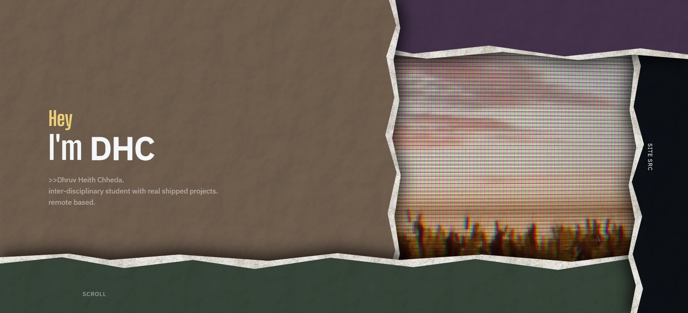

# heith.me

Personal portfolio site. Built with vanilla HTML, CSS, and JavaScript. No frameworks and no build tools. The fonts and the smooth-scrolling library (Lenis) are kept in the repository, so nothing loads from anywhere else. The full visual treatment is enabled on every device; actual smoothness depends on the browser and hardware.

<p align="center">

  <a href="https://github.com/aamosm/heith.me">
    
  </a>

</p>

## Why I Built It This Way

I wanted the site itself to be part of the work I was showing. So the animations, layout, video syncing, animation scheduling and the little browser-specific things all live in the project.

This also meant I had to deal with all the small problems that come with putting all of those things together. That ended up being a big part of the project.

The portfolio is also one of the pieces in the portfolio. It is the site I built to put the rest of my work, process and projects together for me to look at. and if you are here then you too.

## What It Does

The landing page is made from overlapping paper panels with torn edges and noise textures, with a looping video underneath. As you scroll, the panels peel back and reveal more of the CRT footage underneath.

The Design, Devlogs and Projects links sit directly over the video using `mix-blend-mode: difference`. Since the video is constantly changing, the text colour changes with it. A sync script selects authored colour keyframes from the video playback time, keeping the text and its coloured outlines in step with the reel. A second layer over each word lightens or darkens the result to a set colour, which keeps the mix from turning muddy where the footage is mid-toned.

The right panel is `#0D1117`, the same dark background I use on Github. Clicking "site src" expands the panel and takes you to the repository, with the same colour carrying through.

Design, Devlogs and Projects each have their own colour palette. They share the same paper header, menu and CRT layer.

### Full Visuals

There are no hardware or network quality tiers. The palette, coloured outlines, full-resolution reel, scanlines, refresh sweep and glass intro stay enabled on every device. Narrow screens keep their own layout and get the same CRT treatment and favicon flight. If the system asks for reduced motion, looping and entrance animations are skipped.

The cursor follows mouse or pen input, including on devices that also have a touchscreen. Touch alone does not draw a fake mouse pointer.

Paper texture is generated once and kept for later visits. Cursor position work stops when it settles, while the shape continues to morph. Hidden tabs pause video and the smooth-scroll loop.

Browser autoplay restrictions and failed asset requests are still handled so the loader cannot trap the page. These do not select a lower-quality video or a simpler theme.

### Updates and Commits

I work on this site in large updates rather than small, frequent commits. That is simply how I want it to be. This is my personal site, and I only publish changes when I am entirely happy with them. Therefore, you will mostly see large reworks unlike my other projects.

### Hosting and 404s

Internal links and assets remain relative. `404.html` finds the homepage by checking parent `index.html` files for the `dhc-site-root` meta tag. It needs no hard-coded domain or repository name and works at a domain root or a repository subpath. Keep that marker in the landing page.

The repository transition keeps the current page URL until it leaves for GitHub, so refresh and Back do not encounter fabricated local paths. Put these files at the existing site's publishing root. Configure the custom domain and DNS in GitHub Pages separately.

Stylesheet and script links end in `?r=5`. Raise that number in every page whenever CSS or JS changes, so a browser never pairs a new page with an old cached file.

### The Custom Cursor

The cursor is a blob that replaces the normal pointer. It trails behind the mouse with some lag and stretches in the direction it is moving based on its velocity.

The cursor behaviour is adapted from [Xenobiota](https://xenobiota.vercel.app/) by tol-is. The [source](https://github.com/tol-is/xenobiota) is here. I only use the cursor blob behaviour. The full creature system is not part of this site.

### The Favicon

The browser tab starts blank using an inline 1×1 transparent GIF.

During the loading screen, a glass-like favicon appears, moves upward and lands in the browser tab slot. I liked the idea of having something move from the page into the browser itself.

## Where Things Are

```
index.html            landing page
projects/             Projects
devlogs/              Devlogs
site-design/          Design: the portfolio viewer (add ?view=document for the plain pages)
404.html
css/                  base.css is shared; the rest are named for what they style
js/                   site.js is shared; the rest are named for what they run
js/intros.js          the introduction texts; `?intro=name` in the address picks one
js/vendor/            Lenis
fonts/                self-hosted fonts and their licences
assets/               reel, gallery, portfolio images, signature
```

## Licence

The code is under the [MIT License](LICENSE). The artwork, video and other media are not; see [ASSET-LICENSE.md](ASSET-LICENSE.md).

## Things I Looked At

* [xenobiota.vercel.app](https://xenobiota.vercel.app/) by tol-is: cursor blob

* [rithunyaa.github.io](https://rithunyaa.github.io/personal_website2/): layout and presentation

* [pxlin.space](https://pxlin.space/): interaction design

* [sandeep.ramgolam.com](https://sandeep.ramgolam.com/): portfolio structure

* [acid-crunch.com](https://acid-crunch.com/): CRT effects and visual style

* [artemartemartem.com](https://artemartemartem.com/): typography and the video reveal idea
